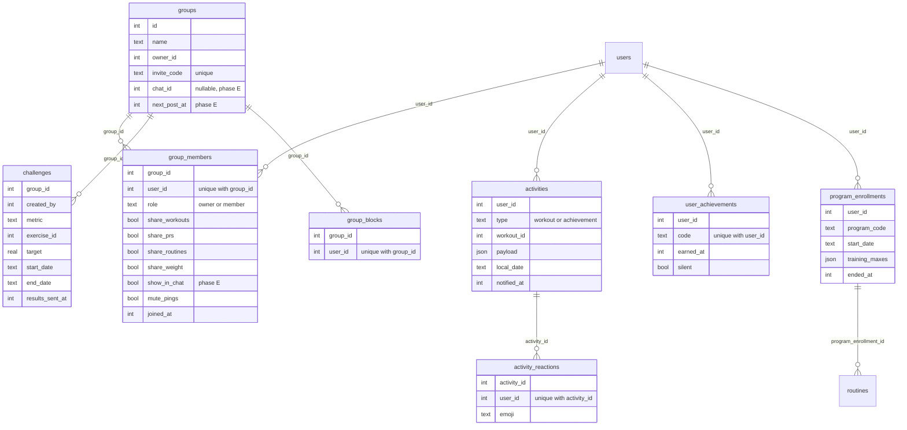
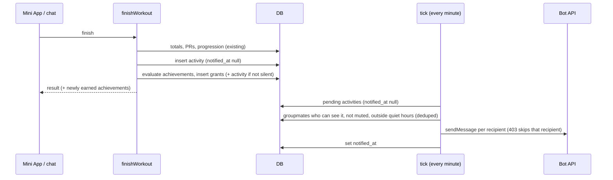
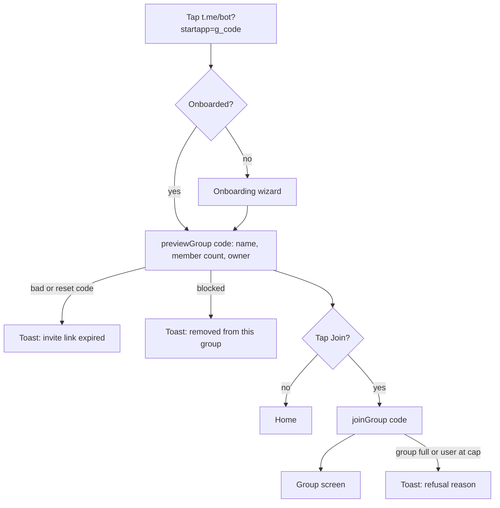
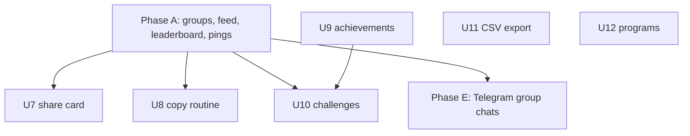

# Friends, Sharing, Engagement and Programs - Plan

## Goal Capsule

- **Objective:** Add a social layer to FitPro: groups joined by invite link, fair leaderboards, an activity feed with reactions and bot pings. Add the features that build on it: a shareable workout card, copying a friend's routine, achievements and streaks, and group challenges. Add two standalone utilities: CSV export and multi-week programs. Telegram group chats come last, as linked groups.
- **Authority:** This plan, then `AGENTS.md` (module rules, no foreign keys, `.deprecated()` drops, i18n), then `docs/i18n.md` (voice and glossary), then existing code conventions in `tgcloud/lib/`.
- **Execution profile:** Phased. Each phase (A to E) ships and deploys independently. Within a phase, follow unit dependency order.
- **Stop conditions:** Stop and ask if a Telegram API behaves differently from what this plan assumes (see Risks). Also stop if a unit needs a foreign key, a column type change or a destructive migration, or if a privacy default would need to change.
- **Tail ownership:** The implementer may run `npm test` and `npm run build`. `npx tgcloud migrate` and `npx tgcloud push` change the live bot's database and deployment. Leave both to the user, or get explicit approval per phase.

---

## Product Contract

### Summary

Users create groups in the Mini App and invite friends with a Telegram link. Each member chooses what the group sees. Groups show a weekly leaderboard that is fair across body sizes, a feed of finished workouts, PRs and achievements with emoji reactions, and optional bot pings. On top of that come a share card for finished workouts, copying a groupmate's routine, achievements and streaks, and group challenges. CSV export and built-in multi-week programs ship independently. Linking a Telegram group chat to a group comes last.

### Problem Frame

FitPro is a single-player tracker. Every table is scoped to one `user_id`, there are no deep links, and nothing can be shared out of the app. Training with friends is one of the strongest retention drivers in fitness apps, and Telegram is where those friends already are. The data a fair comparison needs already exists: `workouts.total_volume_kg`, `workouts.total_sets`, `sets.e1rm_kg`, the append-only `personal_records`, and `users.workouts_per_week`. Nothing exposes it across users. Two gaps users expect from a tracker also remain: getting their data out, and following a structured multi-week program instead of a static weekly schedule.

### Requirements

**Groups and membership**
- R1. A user can create a named group and gets an invite link. The link opens a preview of the group (name, member count, owner), and the user joins only by tapping Join.
- R2. A user who opens an invite link before onboarding sees the group preview once onboarding finishes.
- R3. Members can leave. The owner can rename the group, remove members and reset the invite link. A removed member can't rejoin until the owner resets the link. When the owner leaves, the longest-standing member becomes owner, and when the last member leaves the group is deleted.
- R4. Each membership has its own share settings: workouts, PRs and routines (on by default), body weight and showing up in Telegram chat posts (off by default).
- R24. A group's feed and challenge standings include a member's activity only from the time they joined that group. A viewer likewise sees items only from the time the viewer joined.

**Comparison and feed**
- R5. A group shows a weekly leaderboard with three boards: consistency (workouts done against each member's own weekly goal, plus their goal streak in weeks), volume (weekly volume and sets), and relative strength (best e1RM ÷ body weight on bench, squat and deadlift).
- R6. Relative strength lists only members who share their body weight.
- R7. A group shows a feed of members' finished workouts (with PR highlights when shared) and earned achievements. Members can react with one emoji per item.
- R8. Groupmates get a bot ping when a member finishes a workout. A recipient can mute pings per group, and quiet hours suppress them.
- R9. The existing weekly summary message includes the user's standing in each of their groups.

**Sharing**
- R10. From the workout summary or history, a user can share an image card of a finished workout to any Telegram chat. The card has a button that opens FitPro.
- R11. A member can browse a groupmate's routines (when that member shares routines) and copy one into their own library.

**Engagement**
- R12. Users earn achievements for milestones (first workout, workout counts, first PR, goal-streak lengths, volume milestones). Achievements show on the Progress tab and in group feeds.
- R13. Existing users receive the achievements their history already earns, without flooding feeds or chats.
- R14. A group member can create a challenge with a metric, date range and optional target. The metric is workouts, total volume, working sets, active days, or reps of one exercise. Every member takes part automatically and sees live standings.
- R15. When a challenge ends, participants get the final results in a bot message, once.

**Utility**
- R16. A user can export their data as CSV files (workouts with sets, food log, body weight, measurements). The bot delivers them to the user's chat. Export is rate-limited.
- R17. A user can enroll in a built-in multi-week program (beginner full-body, PPL 12-week, 5/3/1). Enrolling creates the program's routines and weekly schedule, and each workout pre-fills that week's prescribed sets.
- R18. A user can leave a program. Its routines are archived and workout history is kept.

**Telegram group chats**
- R19. Adding the bot to a Telegram group chat creates (or links) a FitPro group for that chat. Chat members join it with one tap.
- R20. A linked chat gets a weekly leaderboard post and responds to a `/leaderboard` command. Posts list only members who turned on "show me in chat posts" for that group.

**Cross-cutting**
- R21. Every new user-facing string has en, ru and uz text, following `docs/i18n.md`.
- R22. `deleteMyData` removes all of the user's rows in new tables and resolves their group ownership.
- R23. No endpoint shows data a user's share settings exclude, and no endpoint shows data across users who share no group.

### Acceptance Examples

- AE1. Covers R2. **Given** a user who has never opened FitPro taps `t.me/<bot>?startapp=g_ab12cd`, **when** they finish onboarding, **then** they see that group's preview. They become a member only after tapping Join.
- AE6. Covers R3. **Given** the owner removed Dan from "Gym", **when** Dan opens the same invite link, **then** joining is refused. After the owner resets the link, Dan can join with the new one.
- AE7. Covers R24. **Given** Eve joins "Gym" on Wednesday, **when** she opens the feed, **then** she sees only items from Wednesday onward. Her own items from before Wednesday don't appear for other members either.
- AE2. Covers R4, R6, R23. **Given** Ali shares weight in "Gym" but not in "Office", **when** Office members load the leaderboard, **then** Ali is missing from relative strength there but still appears in consistency and volume.
- AE3. Covers R8. **Given** Bo has muted "Gym" and Cai's quiet hours are 23:00–07:00, **when** Ali finishes a workout at 23:30 Cai-time, **then** neither Bo nor Cai gets a ping. Both still see the item in the feed.
- AE4. Covers R13. **Given** a user with 60 past workouts, **when** achievements are first evaluated for them, **then** "10 workouts" and "50 workouts" are recorded without a feed item or chat message, and reaching 100 later produces both.
- AE5. Covers R11. **Given** Ali's routine uses Ali's custom exercise "Landmine Press", **when** Bo copies it and Bo has no exercise by that name, **then** Bo gets his own copy of "Landmine Press" and the copied routine points at it. Target weights are left empty.

### Scope Boundaries

- Public profiles, global leaderboards, following users outside a shared group, and direct messages are out of scope.
- Sharing food diaries and progress photos with a group is out of scope. Both stay private.
- User-authored multi-week programs are out of scope. Only built-in templates are planned.

#### Deferred to Follow-Up Work

- Sharing to Stories. `shareToStory` needs a public HTTPS media URL, and the deployment has no public dynamic file hosting. Revisit if static hosting gains uploads.
- Refreshing a feed item when sets of an already-finished workout are edited later.
- Paid features (Telegram Stars).

---

## Planning Contract

### Key Technical Decisions

- KTD1. **Groups live in the Mini App, and a Telegram chat links to one later.** A `groups` row is the single source of truth. Phase E adds a nullable `chat_id`. *Rationale:* Mini App groups work for any set of friends, while chat-only groups would need the bot added to a chat first. Linking keeps one model for both.
- KTD2. **Share settings are per membership, not global.** They live as boolean columns on `group_members` (`share_workouts`, `share_prs`, `share_routines`, `share_weight`, `mute_pings`). *Rationale:* People share differently with gym buddies than with coworkers (AE2).
- KTD3. **One access helper guards every cross-user read, scoped to a group whenever a group is in view.** `tgcloud/lib/social.js` exposes two checks:
  - **Group-scoped:** "can V see M's kind K *in group G*" requires both to be members of G and M to allow K in G. Every group surface uses this: feed, leaderboard, challenge standings and chat posts.
  - **Group-less:** "can V see M's kind K at all" requires at least one shared group where M allows K. Only surfaces that have no group in view use this: reacting to an activity, listing or copying routines, and ping eligibility.

  Ping content is computed per recipient, using only the flags of the groups that recipient shares with the actor. *Rationale:* R23 is a cardinal rule, and one choke point is testable. Scoping to the viewed group keeps per-membership consent (AE2) from leaking through a more permissive group.
- KTD4. **The feed is stored in an `activities` table, written by `finishWorkout` and achievement grants.** Each activity is a per-user row that stores a JSON summary (name, duration, volume, sets, PR highlights). Visibility is decided at read time by KTD3, not by fanning out a copy per group. *Rationale:* Reactions and pings need a stable target. Read-time filtering means changing a share setting takes effect immediately, including for older items. `finishWorkout` in `tgcloud/lib/workouts.js` is the one place both the Mini App and the chat finish flow (`tgcloud/lib/bot/workout.js`) pass through.
- KTD5. **Pings go through a queue that `tick` drains.** The activity row carries `notified_at`, and `tgcloud/lib/notify.js` sends pending pings each minute. *Rationale:* Sending to many groupmates inside `finishWorkout` would slow the finish response and fail halfway on a 403. This mirrors how `processReminders` isolates failures. A recipient in quiet hours is skipped rather than delayed, because a ping hours later is stale.
- KTD6. **Leaderboards use one fixed week window per group.** The window is Monday to Sunday by each member's own `local_date`, and each member's `weekStartsOn` is ignored for comparison. *Rationale:* Every member must be measured over the same days. `local_date` already encodes each user's timezone.
- KTD7. **Relative strength uses the best `e1rm_kg` from the last 90 days, divided by the latest weigh-in.** The lifts are the built-in "Barbell Bench Press", "Back Squat" and "Deadlift", resolved by name among `user_id = 0` exercises. *Rationale:* `sets.e1rm_kg` is already computed on save, and a 90-day window keeps the board current.
- KTD8. **The weekly group digest extends the existing `weekly_summary` reminder rather than adding a scheduler.** `composeReminder` adds group-standing lines. *Rationale:* That reminder is already per-user, timezone-correct and opt-out-able.
- KTD9. **Invite codes are random 8-character `[a-z0-9]` strings, unique-indexed, carried as `startapp=g_<code>`. Opening one shows a preview, and joining needs an explicit tap.** The Mini App reads `start_param` from `Telegram.WebApp.initDataUnsafe` at boot and calls `previewGroup`, which returns the name, member count and owner's first name and reveals no activity. Tapping Join calls `joinGroup`. The server trusts only the code. The bot's `/start g_<code>` replies with the same preview and an inline Join button. *Rationale:* `start_param` allows only `[A-Za-z0-9_-]`. Resetting the code invalidates old links. Requiring a tap means a forwarded link can't expose someone's training without consent.
- KTD19. **Removed members go into a `group_blocks` table (`group_id`, `user_id`), which `resetInvite` clears.** `joinGroup` and `previewGroup` refuse blocked users with `REMOVED_FROM_GROUP`. *Rationale:* Keeping blocks out of `group_members` means no membership query has to filter "removed" rows, which would be a privacy bug waiting to happen.
- KTD20. **Feed and challenge visibility starts at join time.** In group G, an activity is shown only if it was created after both its author's and the viewer's `joined_at` in G. *Rationale:* Joining or inviting someone doesn't open up either side's history.
- KTD10. **The share card is rendered client-side and posted through the progress-photo pattern.** The app draws a PNG on a canvas. An endpoint sends it to the user's own chat to get a `file_id`, deletes that message (same as `uploadPhoto` in `tgcloud/lib/body.js`), and calls `savePreparedInlineMessage` with an `InlineQueryResultCachedPhoto`. The app then calls `Telegram.WebApp.shareMessage(id)`. *Rationale:* No npm packages or image libraries exist server-side, and there is no public file URL. This needs no hosting. The card's button is a URL button to the bot's `startapp` link, because `web_app` buttons are not allowed in inline messages.
- KTD11. **Copying a routine reuses exercises by name, otherwise clones them, and drops target weights.** Built-in exercises are referenced directly. A friend's custom exercise maps to the copier's exercise of the same name (case-insensitive, matching `uidx_exercises_user_name`) or is cloned. *Rationale:* `routine_exercises.exercise_id` must point to an exercise the copier can see. A friend's weights aren't the copier's.
- KTD12. **Achievement definitions live in code, and only grants are stored.** A catalog in `tgcloud/lib/achievements.js` holds the definitions, and a `user_achievements` table (unique `(user_id, code)`) holds grants. A grant is silent (no feed item or ping) when it happens during a user's first evaluation. A new `users.achievements_evaluated_at` column marks that point. It is set on the first evaluation even when nothing is granted, so a new user's real "First workout" is not silenced. *Rationale:* Adding a badge needs no migration. The silent first pass satisfies R13 and AE4.
- KTD13. **Goal streak = consecutive weeks in which finished workouts ≥ `workouts_per_week`.** The current week counts once the goal is met. It is a new function next to `loggingStreak` in `tgcloud/lib/stats.js`. *Rationale:* The existing logging streak counts food and weigh-ins, which is the wrong signal for comparing training consistency.
- KTD14. **Challenge standings are computed at read time from `workouts` and `sets` within the date range.** Every group member participates, and there is no join step. *Rationale:* There are no counters to keep in sync, and no edge cases from edits or deletions.
- KTD15. **The bot delivers CSV export as documents in the user's chat, at most once an hour.** One non-empty file goes out with `sendDocument`. Two or more go out in one `sendMediaGroup` of documents, which requires 2–10 items. A new `users.last_export_at` column enforces the limit. Files are UTF-8 with a BOM so Excel opens Cyrillic correctly. Text cells that start with `=`, `+`, `-`, `@`, tab or CR get a leading `'`, so names copied from a groupmate can't run as spreadsheet formulas. *Rationale:* Downloading from a Mini App inside Telegram's webview is unreliable, and `downloadFile` needs a public URL. `InputFile` uploads are supported (`docs/tgcloud-sdk.md`, *Files*).
- KTD16. **Programs are code templates. Enrolling materializes ordinary routines, and week prescriptions apply when a workout starts.** A `program_enrollments` row records the program, the start date and the training maxes. The routines are normal rows linked through `routines.program_enrollment_id`. `startWorkout` checks whether the routine belongs to an active enrollment, and if so builds that week's planned sets (varying weight/reps per set) in place of the routine's uniform targets. `autoProgress` is off on program routines. *Rationale:* Routines, the schedule, history and the live workout screen keep working unchanged. Only `addExercise` set generation gains a prescription source. The current week is `floor(daysSince(start) / 7)`, so missed days don't stall the program.
- KTD17. **A linked group chat adds members through an explicit join button.** Phase E uses the button rather than syncing the chat roster. *Rationale:* Bots cannot list chat members. Explicit joining also respects per-member share consent, so nobody gets shared without opting in.
- KTD18. **Hard caps:** 10 groups per user, 50 members per group, 5 active challenges per group, feed limited to the last 30 days. *Rationale:* These bound per-request query cost on a serverless isolate, and the ping fan-out per activity.

### High-Level Technical Design

**Data model (new tables; all links are plain integers, no foreign keys):**

**Finish → feed → ping flow:**

**Invite flow:**

**Phase dependencies:**

U7 needs U1 and U2 (bot username and link helpers). U9 can ship alone, and it writes feed items only once U3 exists. U11 and U12 depend on nothing new.

### Sequencing

Ship phases in order A → B → C → D → E. Each phase gets its own schema migration (`npx tgcloud migrate`) before `push`. D can move ahead of B/C if utility matters more than social, since it has no dependency on them.

---

## Implementation Units

| U-ID | Title | Key files | Depends on |
|---|---|---|---|
| U1 | Groups model, membership and access helper | `tgcloud/schema.js`, `tgcloud/lib/groups.js`, `tgcloud/lib/social.js`, `tgcloud/lib/users.js` | — |
| U2 | Invite deep links | `tgcloud/lib/config.js`, `src/App.jsx`, `src/lib/tg.js`, `tgcloud/lib/bot/chat.js` | U1 |
| U3 | Activity feed and reactions | `tgcloud/schema.js`, `tgcloud/lib/activity.js`, `tgcloud/lib/workouts.js` | U1 |
| U4 | Weekly leaderboard | `tgcloud/lib/leaderboard.js`, `tgcloud/lib/stats.js` | U1 |
| U5 | Friends UI | `src/screens/Friends.jsx`, `src/screens/Group.jsx`, `src/i18n/social.js` | U2, U3, U4 |
| U6 | Pings and weekly digest | `tgcloud/lib/notify.js`, `tgcloud/lib/i18n/bot.js` | U3, U4 |
| U7 | Share workout card | `src/lib/share-card.js`, `tgcloud/lib/share.js`, `src/screens/WorkoutSummary.jsx` | U1, U2 |
| U8 | Copy a groupmate's routine | `tgcloud/lib/routines.js`, `src/screens/Group.jsx` | U1, U5 |
| U9 | Achievements and goal streak | `tgcloud/lib/achievements.js`, `tgcloud/lib/stats.js`, `src/screens/Progress.jsx` | — (feed items need U3) |
| U10 | Group challenges | `tgcloud/schema.js`, `tgcloud/lib/challenges.js`, `src/screens/Group.jsx` | U1, U5, U6 |
| U11 | CSV export | `tgcloud/lib/export.js`, `src/screens/Settings.jsx` | — |
| U12 | Multi-week programs | `tgcloud/lib/data/programs.js`, `tgcloud/lib/programs.js`, `tgcloud/lib/workouts.js`, `src/screens/Programs.jsx` | — |
| U13 | Telegram group chats as linked groups | `tgcloud/handlers/my_chat_member.js`, `tgcloud/handlers/message.js`, `tgcloud/lib/bot/group-chat.js` | U1, U4, U6 |

### Phase A — Groups core

### U1. Groups model, membership and access helper

**Goal:** Groups and memberships exist, along with all membership operations and the single cross-user access check.

**Requirements:** R1, R3, R4, R22, R23

**Dependencies:** none

**Files:**
- Modify `tgcloud/schema.js`: add `groups`, `group_members` (unique `(group_id, user_id)`, index on `user_id`, unique `invite_code`) and `group_blocks` (unique `(group_id, user_id)`).
- Create `tgcloud/lib/groups.js`: create, rename, reset invite (also clears blocks), preview by code, join by code, leave, remove member (also blocks), list mine, update my share settings.
- Create `tgcloud/lib/social.js`: `canSee(viewerId, memberId, kind)` and "groupmates of user X who can see kind K".
- Create endpoints `tgcloud/endpoints/createGroup.js`, `previewGroup.js`, `joinGroup.js`, `leaveGroup.js`, `updateGroup.js`, `removeMember.js`, `resetInvite.js`, `listGroups.js`, `updateMembership.js`.
- Modify `tgcloud/lib/users.js` (`deleteAllData`: resolve ownership first, then add `group_members` and `group_blocks`).
- Modify `tgcloud/lib/validate.js`: add enums for role.
- Modify `docs/endpoints.md`: add a Friends section.
- Test: `test/social.mjs` (new, imported from `test/all.mjs`).

**Approach:**
- All endpoints are wrapped by `endpoint(fn, { onboarded: true })` from `tgcloud/lib/endpoint.js`. Refusals use `refuse()` with new codes: `GROUP_FULL`, `GROUP_LIMIT`, `INVITE_INVALID`, `NOT_OWNER`, `REMOVED_FROM_GROUP`.
- `previewGroup` returns the name, member count and owner's first name, plus whether the caller is already a member. It reveals no members or activity.
- Joining is idempotent. A second join returns the group unchanged. Blocked users are refused (KTD19).
- Leaving: if the leaver is owner, transfer to the member with the earliest `joined_at`. If nobody remains, delete the group and its challenges once U10 exists.
- `deleteAllData` calls a "leave all my groups" function before the per-table delete loop, so ownership transfers instead of leaving orphaned groups.
- Invite codes come from `crypto.getRandomValues`. On a unique-index collision, retry once (`isUniqueViolation` in `tgcloud/lib/db-util.js`).

**Patterns to follow:** `tgcloud/lib/routines.js` (own/visible checks, `v.*` validation); `USER_TABLES` ordering in `tgcloud/lib/users.js`.

**Test scenarios:**
- Happy path: user 222 creates "Gym" and becomes owner. User 333 joins by code and becomes a member with default share flags (workouts, PRs, routines on; weight off).
- Joining twice yields one membership.
- `previewGroup` with a valid code returns name, count and owner name, and no member list. A preview creates no membership.
- Covers AE6. A removed user is refused `REMOVED_FROM_GROUP` on both preview and join. After `resetInvite`, they can join with the new code.
- An unknown code and a reset code both refuse with `INVITE_INVALID`. After reset, the old code fails and the new one works.
- Joining a group with 50 members refuses `GROUP_FULL`. Creating or joining an 11th group refuses `GROUP_LIMIT`.
- A non-owner renaming, removing a member or resetting the invite refuses `NOT_OWNER`.
- The owner leaves and ownership passes to the earliest joiner. The last member leaves and the group row is gone.
- Group-scoped check: no shared group → false. In group G with `share_weight` off → false for weight, true for workouts. M shares weight in A but not in B, and V is in both: asked about B → false, asked about A → true.
- Group-less check: the same M and V → true for weight. A viewer who is only in B → false.
- `deleteMyData` for an owner with one other member: that member becomes owner, and no `group_members` rows remain for the deleted user.

**Verification:** `npm test` passes, including `test/social.mjs`. The schema DDL creates the new tables in the `test/run.mjs` DDL step.

### U2. Invite deep links

**Goal:** An invite link opens the Mini App (or the chat) and joins the group, including for users who aren't onboarded yet.

**Requirements:** R1, R2

**Dependencies:** U1

**Files:**
- Modify `tgcloud/lib/config.js`: add `BOT_USERNAME`, and an `inviteLink(code)` helper in `tgcloud/lib/groups.js` that returns `https://t.me/<bot>?startapp=g_<code>`.
- Modify `src/lib/tg.js`: export `startParam` from `initDataUnsafe.start_param`.
- Modify `src/App.jsx`: once the user is onboarded and the start param matches `g_`, push a `GroupInvite` screen once per session. That screen calls `previewGroup` and shows a Join button (`MainButton`). Joining opens the `Group` screen. Create `src/screens/GroupInvite.jsx`.
- Modify `tgcloud/lib/bot/chat.js` (`start`) and `tgcloud/handlers/message.js`: parse `/start g_<code>` and reply with the preview text and an inline Join button (callback `g:join:<code>`, dispatched in `tgcloud/handlers/callback_query.js`). After joining, the message is edited to "You joined {group}" with an app button opening the group. A user who isn't onboarded gets the setup button, and the code is saved in `bot_state`.
- Modify `tgcloud/lib/account.js` (`completeOnboarding`): if `bot_state` holds a pending invite code, send the preview-and-Join message. Do not join automatically.
- Test: `test/social.mjs`, `test/bot.mjs`.

**Approach:**
- Bot buttons that open a group (the join confirmation here, and pings in U6) are `web_app` buttons to `MINI_APP_URL + '?group=<id>'`, because `web_app` launches carry no `start_param`. `App.jsx` reads `group` from `location.search` and pushes the Group screen once per session, alongside the `g_` start-param check. The viewer must be a member, otherwise the app shows Home.
- The Mini App path needs no server-side pending state: `start_param` stays in init data for the whole session, so `App.jsx` checks it again after the onboarding screen finishes.
- Keep a session flag so navigating back doesn't re-trigger the join.
- The main Mini App must be configured in BotFather for `t.me/<bot>?startapp=` to open it. That is a deployment prerequisite (see Risks).

**Test scenarios:**
- Covers AE1. Bot path: `/start g_<code>` from a user who isn't onboarded saves the pending code. After `completeOnboarding` they get the preview with a Join button and are not yet a member.
- `/start g_<code>` from an onboarded user replies with the preview and creates no membership. Tapping Join creates it and edits the message to "You joined {group}".
- `/start g_<code>` from a removed user replies with the "removed from this group" text.
- `/start g_badcode` replies with the "invite link expired" text and does not throw.
- Plain `/start` behaves exactly as today.

**Verification:** Bot tests pass. Manually, opening the link in Telegram on a second account joins the group.

### U3. Activity feed and reactions

**Goal:** Finishing a workout records a feed item, and groupmates can read a filtered feed and react.

**Requirements:** R7, R23, R24

**Dependencies:** U1

**Files:**
- Modify `tgcloud/schema.js`: add `activities` (index `(user_id, created_at)`, partial index on `notified_at IS NULL`) and `activity_reactions` (unique `(activity_id, user_id)`).
- Create `tgcloud/lib/activity.js`: record a workout activity, record an achievement activity, get the group feed, set or clear a reaction.
- Modify `tgcloud/lib/workouts.js`: `finishWorkout` records the activity after totals and PRs. `discardWorkout` and `deleteWorkoutRows` also delete that workout's activity and its reactions.
- Create endpoints `tgcloud/endpoints/getGroupFeed.js` and `react.js`.
- Modify `tgcloud/lib/users.js`: in `deleteAllData`, delete reactions on the user's activities, then the user's reactions, then the activities.
- Test: `test/social.mjs`.

**Approach:**
- The payload is a summary snapshot: workout name, duration, volume, sets, and PR highlights excluding `reps_at_weight`, the same filter the chat finish message uses.
- The feed query: member IDs of the group who allow `workouts` in that group, their activities from the last 30 days that also pass the join-time rule (KTD20), newest first, with cursor pagination by `id`. Achievement items follow the same `share_workouts` gate. PR highlights are stripped from the payload at read time when the member's `share_prs` is off in that group.
- Reactions come from a fixed set (👏 🔥 💪). The viewer must be able to see the activity (KTD3), otherwise the reaction is refused as not found.
- Reaction counts, plus the viewer's own reaction, are returned with each item.

**Patterns to follow:** The `prHighlights` usage in `finishWorkout`. `toWire` handles dates in responses.

**Test scenarios:**
- Happy path: 222 finishes a workout with a PR. 333 (same group) sees one item that includes the PR highlight.
- Covers AE7. A workout 222 finished before 333 joined doesn't appear for 333. A workout 333 finished before joining doesn't appear for 222.
- After 222 turns off `share_prs`, 333 sees the item without PR highlights. After `share_workouts` is off, 333 sees no item.
- User 444 in no shared group calling `getGroupFeed` for that group refuses as not found. Reacting to 222's activity also refuses.
- A reaction toggles: a second identical call clears it, and a different emoji replaces it.
- A discarded or empty workout produces no activity. A workout deleted after finishing removes its activity.
- Finishing from the chat (`test/bot.mjs` finish flow) also records an activity.

**Verification:** Tests pass. A finish from chat or the app produces exactly one activity.

### U4. Weekly leaderboard

**Goal:** A fair weekly leaderboard per group, with three boards.

**Requirements:** R5, R6, R23

**Dependencies:** U1

**Files:**
- Create `tgcloud/lib/leaderboard.js`: compute boards for a group and a week.
- Modify `tgcloud/lib/stats.js`: add the goal-streak function (KTD13), exported for U6 and U9.
- Create endpoint `tgcloud/endpoints/getGroup.js`: group info, members (name, role, my share settings), invite link for owners, and the leaderboard for `week?` (any date in the week, default current).
- Test: `test/social.mjs`.

**Approach:**
- Week window per KTD6. Consistency: `done / workouts_per_week` (display capped at 100%, sort by ratio and then by streak) plus the streak in weeks. Volume: summed `total_volume_kg` and `total_sets` of finished workouts in the window.
- Relative strength per KTD7: one row per lift per sharing member, plus a combined score (the sum of the three ratios) for sorting. A lift with no data shows as empty, not zero.
- Only members who allow `workouts` appear on consistency and volume, and only members who allow `weight` appear on relative strength.
- Batch the queries per group (`inArray` over member IDs), not per member, to bound cost (KTD18).

**Test scenarios:**
- Goal 3, 2 done → 67%. Goal 2, 3 done → 100%, ranked above the 67% member.
- Goal streak: goal met in each of the last 3 completed weeks and not yet this week → 3. Goal already met this week → 4. A missed week in between resets the count.
- Covers AE2. A member sharing weight in one group but not another appears on relative strength only in the first.
- Relative strength: bench e1RM 100 kg at 80 kg bodyweight → 1.25. No weigh-in → excluded with no error.
- Workouts outside the Monday–Sunday window, and unfinished workouts, are not counted.
- A user in no shared group calling `getGroup` refuses as not found.

**Verification:** Tests pass. The numbers match hand-computed fixtures.

### U5. Friends UI

**Goal:** Users can create, join, view and manage groups in the Mini App.

**Requirements:** R1, R3, R4, R5, R7, R21

**Dependencies:** U2, U3, U4

**Files:**
- Create `src/screens/Friends.jsx`: my groups and a create sheet.
- Create `src/screens/Group.jsx`: leaderboard segmented control (Consistency / Volume / Strength), feed with reactions, members, invite button.
- Create `src/screens/GroupSettings.jsx`: my share toggles, mute pings, leave. The owner also gets rename, reset link and remove member.
- Modify `src/App.jsx` (`SCREENS`), `src/screens/Home.jsx` (Friends card) and `src/screens/Progress.jsx` (Friends entry row).
- Create `src/i18n/social.js` and merge it in `src/lib/i18n.js`.
- Modify `src/lib/tg.js`: a `shareLink(url, text)` helper that uses `openTelegramLink('https://t.me/share/url?…')`.

**Approach:**
- No sixth tab. Five tabs already fill the bar, so Friends is reached from a Home card and a Progress row.
- The invite button opens Telegram's share sheet with the link and a translated invitation line.
- Use existing kit components (`Section`, `List`, `Row`, `Segmented`, `Sheet`, `MainButton`, `Switch`) and `useApi`/`invalidate` from `src/lib/api.js`.
- Weight values display through `fmt.w` in the viewer's unit. Relative strength shows as "1.25× BW".
- Empty states: no groups ("Train together — create a group and invite friends"), and a group with only you (prominent invite).

**Patterns to follow:** `src/screens/Settings.jsx` (sheets, switches, `saveQuiet`), `src/screens/History.jsx` (lists), and the i18n conventions in `docs/i18n.md` (call `t()` at render time).

**Test scenarios:**
- Test expectation: no automated UI tests exist in this repo. Behavior is covered by the U1–U4 endpoint tests. Manually check, in Telegram on two accounts: create, invite, join, react, toggle share weight (strength board updates), leave, and owner transfer.

**Verification:** `npm run build` succeeds. Every new string has ru and uz entries, and a language switch shows translated screens.

### U6. Pings and weekly digest

**Goal:** Groupmates get a ping when a member finishes, and the weekly summary includes group standings.

**Requirements:** R8, R9

**Dependencies:** U3, U4

**Files:**
- Modify `tgcloud/lib/notify.js`: a `processActivityPings(now)` step in `tick`, and group lines in the `weekly_summary` case of `composeReminder`.
- Modify `tgcloud/lib/i18n/bot.js`: ru and uz strings.
- Test: `test/endpoints.mjs` (alongside the existing `processReminders` tests) or `test/social.mjs`.

**Approach:**
- Take up to 100 pending activities of type `workout` per tick, and stop once 200 sends have gone out in that tick, so the step can't starve `processReminders`. An activity that didn't fit is picked up on the next tick.
- Recipients are groupmates who can see workouts in some shared group (KTD3), haven't muted every such group, and are outside their own quiet hours (`inWindow(localTime(...))`). A recipient in two shared groups gets one ping. The PR line is included only if the actor shares PRs in a group the recipient is also in.
- Per-actor cooldown: an activity whose actor already had a ping sent in the last hour is marked notified without sending. This stops a member from spamming the group with tiny back-to-back workouts.
- Mark `notified_at` before sending. A failed send is logged and skipped, never retried, so one bad recipient can't jam the queue (same stance as `processReminders`). A 403 just skips that recipient.
- The ping text, in the recipient's language: "💪 {name} finished {workout} — {n} sets, {volume}" plus "🏆 {n} new records" when PRs are shared. It carries an app button that deep-links to the group.
- The weekly digest adds one line per group: "{group}: #{rank} of {n} in consistency". It is skipped when the user has no groups.

**Test scenarios:**
- Covers AE3. Muted recipient → no send. Recipient in quiet hours → no send. Both still have the item in `getGroupFeed`.
- A recipient sharing two groups with the actor gets exactly one send.
- The actor never receives their own ping.
- A recipient who shares only a group where the actor has `share_prs` off gets the ping without the PR line.
- Two finishes by the same actor within an hour → one ping, and both activities are marked notified.
- More than 200 eligible sends in one tick → the rest go out on the next tick.
- A second tick sends nothing for an already-notified activity.
- A send that throws a 403 for one recipient still delivers to the others, and `notified_at` is set.
- The weekly summary of a user in one group includes the standing line. A user with no groups gets today's text unchanged.

**Verification:** Tests pass with the `api` shim recording sends.

### Phase B — Sharing

### U7. Share workout card

**Goal:** A finished workout can be shared to any chat as an image card with an "Open FitPro" button.

**Requirements:** R10, R21

**Dependencies:** U1, U2 (`BOT_USERNAME` and the `startapp` link helper)

**Files:**
- Create `src/lib/share-card.js`: draws the card on a canvas (workout name, date, duration, sets, volume, up to 3 PRs, FitPro mark), themed light, at 1080×1350, and returns base64 PNG.
- Create `tgcloud/lib/share.js` and endpoint `tgcloud/endpoints/prepareShare.js`: validate ownership of a finished workout, upload the image to get a `file_id`, delete the message, then call `savePreparedInlineMessage` and return `{ id }`.
- Modify `src/screens/WorkoutSummary.jsx` and the workout detail in `src/screens/History.jsx`: add a Share button, shown only when `tg.isVersionAtLeast('8.0')`.
- Modify `src/i18n/workout.js`.
- Test: `test/endpoints.mjs`.

**Approach:**
- Follows KTD10. Reuse `decodeBase64` and `imageType` and the size limit from the `uploadPhoto` flow in `tgcloud/lib/body.js`, ideally by extracting a shared "upload image to own chat, get file_id" helper rather than duplicating it.
- `savePreparedInlineMessage` gets `user_id`, a `photo` result with a caption built server-side from the stored workout (not taken from the client), a URL button to `https://t.me/<bot>?startapp=ref`, and `allow_user_chats`, `allow_group_chats` and `allow_bot_chats` set to true.
- The card's text is translated at render time in the app.

**Test scenarios:**
- Happy path: the owner of a finished workout gets an `id`. The shim records `sendPhoto`, then `deleteMessage`, then `savePreparedInlineMessage` with a cached photo result.
- Another user's workout refuses as not found. An unfinished workout refuses with a new `NOT_FINISHED` code.
- A non-image payload or an oversized image refuses `INVALID_INPUT` (same as `uploadPhoto`).
- When `deleteMessage` fails, the share still succeeds and a warning is logged.
- The shim throws a 403 on `sendPhoto` → refuse `BOT_CHAT_REQUIRED`.

**Verification:** Tests pass. Manually, in Telegram 8.0+, the share sheet opens and the posted card shows the button.

### U8. Copy a groupmate's routine

**Goal:** Browse a groupmate's routines and copy one.

**Requirements:** R11, R23

**Dependencies:** U1, U5

**Files:**
- Modify `tgcloud/lib/routines.js`: list a member's routines through `canSee(..., 'routines')`, and add `copyRoutine`.
- Create endpoints `tgcloud/endpoints/listMemberRoutines.js` and `copyRoutine.js`.
- Modify `src/screens/Group.jsx` (member row → routines sheet → copy) and `src/i18n/social.js`.
- Test: `test/social.mjs`.

**Approach:**
- Follows KTD11. The copy is built as a `saveRoutine` input (items without IDs) and goes through `saveRoutine`, so validation, superset normalization and positioning are reused.
- The name is kept, with " ({firstName})" appended when it clashes with one of the copier's active routines.
- Copy sets, rep range, duration, rest, superset group and notes. Leave target weight null, and keep `autoProgress` at the copier's defaults.
- Archived routines and archived exercises are not offered.
- Cloned exercises go through the same validation as `saveExercise` (name and notes limits), so a groupmate's text can't bypass input rules.

**Test scenarios:**
- Covers AE5. A custom exercise is cloned for the copier when no exercise with that name exists. When one exists (different case), it is reused. Built-in exercises are referenced as-is.
- The copied routine has the same structure and supersets, and target weights are null.
- A name clash gets the suffix.
- A member with `share_routines` off → listing and copying refuse as not found. A user in no shared group → refuse.

**Verification:** Tests pass. The copied routine starts a workout normally.

### Phase C — Engagement

### U9. Achievements and goal streak

**Goal:** Earn and display achievements, and backfill existing users silently.

**Requirements:** R12, R13, R21

**Dependencies:** none. Feed items are written only when U3 exists.

**Files:**
- Modify `tgcloud/schema.js`: add `user_achievements`.
- Create `tgcloud/lib/achievements.js`: the catalog (code, English title key, icon, check over a stats snapshot), `evaluate(user)` returning newly earned grants, and `listAchievements(user)`.
- Modify `tgcloud/lib/workouts.js`: `finishWorkout` evaluates and returns `achievements`. Non-silent grants record an activity (U3).
- Create endpoint `tgcloud/endpoints/getAchievements.js`.
- Modify `src/screens/Progress.jsx` (achievements section), `src/screens/WorkoutSummary.jsx` (newly earned), `tgcloud/lib/bot/workout.js` (one line in the chat finish message), `src/i18n/progress.js` and `tgcloud/lib/i18n/bot.js`.
- Modify `tgcloud/lib/users.js` (`USER_TABLES`).
- Test: `test/run.mjs` (catalog checks against fixtures), `test/social.mjs` or `test/endpoints.mjs` (finish flow).

**Approach:**
- The starting catalog: first workout; 10, 50, 100 and 250 workouts; first PR; 10 PRs; goal streak of 4, 12 and 26 weeks; a single session over 10 t of volume; 100 t lifetime volume.
- The stats snapshot is one batch of aggregate queries (workout count, PR count excluding baselines, lifetime volume, max session volume, goal streak), not one query per badge.
- Grants are marked `silent` only when `users.achievements_evaluated_at` was null before the call (add this column in this unit's migration). The first evaluation runs at the user's next finish, or lazily on `getAchievements`, whichever comes first.

**Test scenarios:**
- Covers AE4. 60 past workouts on first evaluation → 10 and 50 granted silently with no activity rows. Reaching the 100th afterwards → a non-silent grant plus an activity.
- A finish that crosses no threshold → empty `achievements`.
- A brand-new user who opened Progress (evaluated, nothing earned) then finishes their first workout → "First workout" is non-silent and produces an activity.
- Evaluating twice never duplicates a grant (unique index, insert-or-ignore).
- PR baselines (`isFirst`) don't count toward "first PR".
- `deleteMyData` removes the grants.

**Verification:** Tests pass. The Progress tab shows earned and locked badges in all three languages.

### U10. Group challenges

**Goal:** Members create time-boxed challenges with live standings and a one-time results message.

**Requirements:** R14, R15, R21, R23

**Dependencies:** U1, U5, U6

**Files:**
- Modify `tgcloud/schema.js`: add `challenges` (index `(group_id, end_date)`, partial index on `results_sent_at IS NULL`).
- Create `tgcloud/lib/challenges.js`: create, delete (creator or owner), list for a group with standings, and process ended challenges.
- Create endpoints `tgcloud/endpoints/createChallenge.js`, `deleteChallenge.js`, `listChallenges.js`.
- Modify `tgcloud/lib/notify.js`: add `processEndedChallenges` to `tick`.
- Modify `tgcloud/lib/groups.js`: deleting a group deletes its challenges.
- Modify `tgcloud/lib/users.js` (`deleteAllData`): set `created_by` on the user's challenges to the group's owner after ownership transfers. Challenges in groups the user's departure deleted go with the group.
- Modify `src/screens/Group.jsx` (Challenges section and create sheet), `src/i18n/social.js` and `tgcloud/lib/i18n/bot.js`.
- Modify `tgcloud/lib/validate.js`: add an enum for the metric (`workouts`, `volume_kg`, `sets`, `active_days`, `exercise_reps`).
- Test: `test/social.mjs`.

**Approach:**
- Follows KTD14. Standings count only members who allow `workouts`, and use each member's `local_date` within `[start_date, end_date]`. A member who joins mid-challenge counts only workouts finished after their `joined_at` (KTD20). `exercise_reps` sums completed non-warmup reps of one exercise and requires an `exercise_id` visible to the creator. In practice that means a built-in exercise, because custom exercises aren't shared.
- A challenge has ended once `end_date` is before today in the group owner's timezone (UTC if that lookup fails). Ownership always survives account deletion, which the creator may not. Then the results message (top 3, the recipient's own rank, and whether the target was hit) is sent once per participant, honoring the 403 skip. `results_sent_at` is set first.
- Limits: at most 5 active per group (KTD18), duration 1–90 days, and the start date can't be in the past.

**Test scenarios:**
- Each metric over a fixture week gives the expected standings: workouts, volume, sets, active days (two workouts on one day count once), and push-up reps.
- A workout outside the date range is ignored. A member with `share_workouts` off is absent. A member who joined on day 3 of a challenge has their day 1–2 workouts excluded.
- A 6th active challenge refuses. A start date in the past or a duration over 90 days refuses `INVALID_INPUT`.
- Deletion by a non-creator non-owner refuses `NOT_OWNER`.
- An ended challenge sends results once, and a second tick sends nothing.
- The creator deletes their data before the end date → `created_by` becomes the owner, results still send, and no challenge row references the deleted ID.

**Verification:** Tests pass. Results messages read correctly in en, ru and uz.

### Phase D — Utility

### U11. CSV export

**Goal:** The user receives their data as CSV files in the bot chat.

**Requirements:** R16, R21

**Dependencies:** none

**Files:**
- Modify `tgcloud/schema.js`: add `users.last_export_at`.
- Create `tgcloud/lib/export.js`: CSV builders (workouts with one row per set, food logs, body weights, measurements), RFC 4180 escaping, UTF-8 BOM, and delivery through `sendMediaGroup` of documents.
- Create endpoint `tgcloud/endpoints/exportData.js`.
- Modify `src/screens/Settings.jsx` (a "Your data" section with an Export row next to delete-my-data), `src/i18n/account.js` and `tgcloud/lib/i18n/bot.js`.
- Modify `docs/endpoints.md`.
- Test: `test/run.mjs` (CSV escaping), `test/endpoints.mjs` (endpoint and rate limit).

**Approach:**
- Follows KTD15. Values are in metric storage units, with column headers naming the units (`weight_kg`). Exercise and food names are the user's language via `catalogName`. Dates are `local_date`.
- An empty dataset is skipped. When everything is empty, refuse with `NOTHING_TO_EXPORT`.
- Set `last_export_at` only after a successful send. A second request within an hour refuses `RATE_LIMITED` with `retryAfterSec`.

**Test scenarios:**
- Escaping: a value containing a comma, a quote or a newline is quoted, with quotes doubled. Cyrillic survives, and a BOM is present.
- A user with workouts and weights gets two documents in one `sendMediaGroup`. Food and measurements are skipped when empty.
- A user with only body weights (the state right after onboarding) gets one `sendDocument` and no `sendMediaGroup`.
- An exercise named `=HYPERLINK("x")` is written as `'=HYPERLINK(""x"")`.
- The shim throws a 403 on send → refuse `BOT_CHAT_REQUIRED`, and `last_export_at` is unchanged.
- A second export within an hour → `RATE_LIMITED`. After an hour, allowed again.
- A send failure (shim throws) leaves `last_export_at` unchanged.

**Verification:** Tests pass. Manually, the files open in Excel and Google Sheets with correct columns.

### U12. Multi-week programs

**Goal:** Enroll in a built-in program. Workouts pre-fill each week's prescription.

**Requirements:** R17, R18, R21

**Dependencies:** none

**Files:**
- Create `tgcloud/lib/data/programs.js`: three templates. Each has days, the exercises per day (by built-in name), and a per-week prescription function (week index, training maxes) → sets of `{ weightKg, reps, setType }`.
- Modify `tgcloud/schema.js`: add `program_enrollments` (unique active enrollment per user via a partial unique index on `ended_at IS NULL`) and `routines.program_enrollment_id`.
- Create `tgcloud/lib/programs.js`: list programs, enroll, get my program (current week, next session), leave.
- Modify `tgcloud/lib/workouts.js` (`startWorkout`/`addExercise`): use the program prescription when the routine belongs to the active enrollment.
- Create endpoints `tgcloud/endpoints/listPrograms.js`, `enrollProgram.js`, `getMyProgram.js`, `leaveProgram.js`.
- Create `src/screens/Programs.jsx` (catalog, detail, enroll sheet with training-max inputs for 5/3/1). Modify `src/screens/Train.jsx` (entry and current-program card), `src/i18n/workout.js` and `tgcloud/lib/i18n/catalog.js` if program names are translated there.
- Modify `tgcloud/lib/users.js` (`USER_TABLES`).
- Test: `test/run.mjs` (prescription math), `test/endpoints.mjs` (enroll → start → planned sets).

**Approach:**
- Follows KTD16. The templates:
  - **Beginner full-body**, 3 days/week, 8 weeks. Linear progression comes from the template (+2.5 kg upper / +5 kg lower when the last session hit all reps), computed from the previous session's sets.
  - **PPL**, 6 days, 12 weeks. Double progression within rep ranges, with every 4th week a deload at 60% volume.
  - **5/3/1**, 4 days, repeating 4-week cycles. Week percentages are 65/75/85, 70/80/90, 75/85/95, then a deload. Training max = 90% of the entered or estimated 1RM, and +2.5/+5 kg per cycle.
- Enrolling:
  - Refuse if already enrolled (`PROGRAM_ACTIVE`).
  - Create the program's routines with `autoProgress` off.
  - Replace the schedule. Confirm this in the UI, because it overwrites the user's weekly plan.
  - Prefill 5/3/1 training maxes from the best 90-day `e1rm_kg`. The user can edit them.
- Week index = `floor(daysBetween(start_date, today) / 7)`. After the last week, a fixed-length program ends itself, and 5/3/1 rolls to the next cycle. The end is applied lazily, the first time `getMyProgram` or `startWorkout` sees the week index past the end. It runs the same cleanup as leaving.
- `getWorkout` returns a null `target` for exercises in a workout started from an active program routine, so the live screen and chat card show the planned sets rather than contradicting uniform routine targets.
- Leaving archives the program's routines (`archiveRoutine`), clears schedule days that point at them, and sets `ended_at`.

**Test scenarios:**
- 5/3/1 week 2, bench TM 100 kg → planned working sets 70/80/90 kg × 3/3/3+, rounded to 2.5 kg.
- PPL week 4 → deload volume. Week 5 → back to normal.
- Enrolling creates the expected routines and schedule. Starting today's routine produces the prescribed planned sets, not the routine's uniform targets.
- A second enrollment refuses `PROGRAM_ACTIVE`.
- Leaving archives the routines, removes their schedule days, and keeps finished workouts.
- A routine from an ended enrollment starts with ordinary routine targets.
- `applyProgression` does not change program routines (`autoProgress` off).

**Verification:** Tests pass. A week of simulated dates walks the prescription correctly.

### Phase E — Telegram group chats

### U13. Telegram group chats as linked groups

**Goal:** Adding the bot to a group chat creates or links a FitPro group, which members join by button and which gets weekly leaderboard posts.

**Requirements:** R19, R20, R21

**Dependencies:** U1, U4, U6

**Files:**
- Modify `tgcloud/schema.js`: add `groups.chat_id` (unique where not null), `groups.next_post_at`, `group_members.show_in_chat` (default false), and `users.bot_started_at` (set by the private-chat `/start` handler in `tgcloud/lib/bot/chat.js`).
- Create `tgcloud/handlers/my_chat_member.js`. When the bot becomes a member in a `group` or `supergroup` chat, it checks the adder: they must be onboarded, under the group cap, and a chat administrator (`getChatMember`).
  - If all three hold, create a group named after the chat, owned by the adder, and post a "Join" button (callback `g:join:<code>`, the same callback as the private-chat invite in U2).
  - Otherwise, post a setup message with a URL button to the bot.
  - A chat that is already linked is never re-linked.
  - When the bot is removed, unlink `chat_id` but keep the group.
- Modify `tgcloud/handlers/message.js`: in group chats, handle only `/leaderboard` (and `/leaderboard@<bot>`) and ignore everything else. The current early return for non-private chats becomes a branch.
- Modify `tgcloud/handlers/callback_query.js`: dispatch the `g:join` prefix before the existing onboarding guard. That guard would post a `web_app` button into the group chat, which Telegram rejects outside private chats. A tapper without `bot_started_at` and `onboardedAt` gets `answerCallbackQuery({ url })` with the bot's `start=g_<code>` link, and no membership is created.
- Create `tgcloud/lib/bot/group-chat.js`: render the leaderboard text, the join flow and the weekly post.
- Modify `tgcloud/lib/notify.js`: add `processGroupChatPosts`, which runs when `next_post_at` is due (Monday 10:00 in the owner's timezone).
- Modify `src/screens/GroupSettings.jsx`: show the linked chat, and add a "Show me in chat posts" toggle (off by default).
- Chat posts and `/leaderboard` list only members with `show_in_chat` on who also share workouts. When nobody has opted in, the post tells members where to turn it on.
- Modify `tgcloud/lib/i18n/bot.js`. Chat posts use the owner's language.
- Test: `test/bot.mjs`.

**Approach:**
- Follows KTD1 and KTD17. Bot privacy mode stays on, so the bot sees only commands.
- Every button in a group-chat message is a URL button to the bot's `startapp`/`start` link, never `appButton` (`web_app`).
- A chat migrating to a supergroup (`migrate_to_chat_id`) updates `chat_id`.
- When a post fails with 403 or "chat not found", unlink the chat.
- After deploy, `npx tgcloud webhook` should show `my_chat_member` among the allowed updates. The platform derives this from `handlers/` on `push`.

**Test scenarios:**
- Adding the bot to a chat (adder onboarded, admin, under cap) creates a linked group and posts the join button. Adding it again to the same chat is idempotent.
- The adder is not onboarded, not an admin, or at the group cap → no group, and a setup message with a URL button is posted.
- A second admin re-adding the bot to an already-linked chat does not change the owner.
- Tapping Join as an onboarded user creates a membership. Tapping as a user who never started the bot answers with a start link and creates no membership.
- `/leaderboard` in a linked chat posts the consistency board with only `show_in_chat` members. A member who joined but didn't opt in is absent. With no opted-in members, it posts the "turn it on in settings" hint. In an unlinked chat it explains how to set up. Other group messages are ignored.
- Removing the bot unlinks the chat but keeps the group and its members.
- A weekly post sends once when due and reschedules to the next Monday. A 403 unlinks the chat.

**Verification:** Bot tests pass. Manually, in a real test group, add the bot, join, run `/leaderboard`, and remove the bot.

---

## System-Wide Impact

- **Privacy boundary:** Before this work, no endpoint returned another user's data. Every social read now goes through KTD3, so tests for "user in no shared group" and "flag off" are required in each unit that reads across users.
- **`finishWorkout` grows:** It now records an activity, evaluates achievements and returns achievements. Both the Mini App and the chat finish path change behavior. Keep the added work to a few batched queries, because pings are deferred to `tick`.
- **`tick` gains steps:** activity pings, ended challenges and group chat posts. Each step is bounded (`limit`) and isolates failures, so one slow step can't stop reminders.
- **Data lifecycle:** `deleteAllData` must handle ownership transfer, reactions on the user's activities, and every new per-user table. A new `test/social.mjs` case asserts that no rows remain for the deleted ID in any new table.
- **Schema migrations:** Four migrations, one each for Phases A, C, D and E (Phase B has no schema change). All are additive (new tables, nullable columns), and none needs `.deprecated()` or a type change.
- **Own-chat sends:** Users who join by invite may never have opened the bot chat. Every endpoint that sends to the caller's own chat (U7, U11) turns a 403 into a `BOT_CHAT_REQUIRED` refusal. The app then calls `Telegram.WebApp.requestWriteAccess()` and retries.

---

## Risks & Dependencies

| Risk | Mitigation |
|---|---|
| `t.me/<bot>?startapp=` opens the Mini App only when a main Mini App is configured in BotFather | Before Phase A ships, check that the bot has a main Mini App. Otherwise configure one, or switch invites to a direct link `t.me/<bot>/<app>?startapp=`. |
| `savePreparedInlineMessage` might require inline mode or behave differently with cached photos | Verify against the live Bot API during U7, and stop if it differs (Goal Capsule). Fall back to a text article result with the same button. |
| Ping volume: a 50-member group that is very active could send hundreds of messages a minute | Per-tick limit of 100 activities and dedupe per recipient. Pings are mutable and default on. Revisit with a per-recipient daily cap if users complain. |
| Leaderboard and challenge queries on a serverless isolate | Batch per group with `inArray`. The caps in KTD18 bound the work. |
| Program templates encode training methodology | Keep prescriptions in one data file with tests on the math, and label them as standard public programs. |
| Pings, challenge results, the group digest and chat posts run only when an external scheduler calls `tick`. `SCHEDULER_USER_IDS` in `tgcloud/lib/config.js` is empty in the repo, so every tick call is refused unless that list is set in production | Before shipping U6, confirm in the logs that the per-minute scheduler is calling `tick` successfully. Tests call the process functions directly and won't catch this. |
| `my_chat_member` and group messages are new update types for this bot | Run `npx tgcloud webhook` after the Phase E push, and `npx tgcloud webhook sync` if it shows drift. |

---

## Verification Contract

| Gate | Command / check | Applies to |
|---|---|---|
| Unit and endpoint tests | `npm test` (runs `test/all.mjs`: `run.mjs`, `endpoints.mjs`, `bot.mjs`, plus new `social.mjs`) | Every unit |
| Front-end build | `npm run build` | U2, U5, U7, U8, U9, U10, U11, U12, U13 |
| Schema preview | `npx tgcloud status` shows only additive changes | Every unit touching `tgcloud/schema.js` |
| Translations | Every new `t()` key has ru and uz entries in the matching `src/i18n/*.js` or `tgcloud/lib/i18n/bot.js`, checked by switching languages in the app | Every unit with UI or bot text |
| Live check (user-run) | `npx tgcloud migrate` then `npm run deploy` per phase, then a two-account manual walkthrough | End of each phase |

---

## Definition of Done

- All units in the shipped phase meet their Verification line, and `npm test` and `npm run build` pass.
- Each acceptance example (AE1–AE7) has a passing test, or a recorded manual check where it is UI-only.
- `deleteMyData` leaves no rows for the user in any new table, and transfers group ownership.
- No social endpoint returns data outside KTD3, as shown by negative tests in U1, U3, U4, U8 and U10.
- `docs/endpoints.md` documents every new endpoint and error code.
- No dead code from abandoned approaches is left in the diff, and no debug logging beyond existing `console.warn`/`console.error` conventions.
